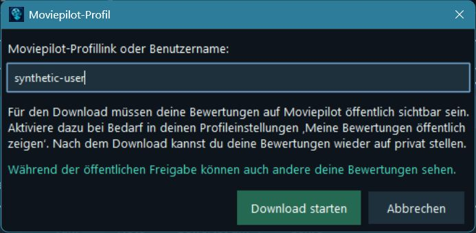

<p align="center"></p>

# FilmKompass 1.0

**Kostenloses Windows-Tool zum Herunterladen, Archivieren, Durchsuchen und Exportieren deiner öffentlich sichtbaren Moviepilot-Bewertungen.**

Excel-/CSV-Export- und Archivtool für deine Moviepilot-Bewertungen.

**Unabhängiges Projekt, nicht offiziell mit Moviepilot verbunden.**

## Downloads

**Windows 11 x64 · keine Python-Installation · keine Administratorrechte**

- [FilmKompass 1.0 für Windows herunterladen](https://github.com/Stigliz81/FilmKompass/releases/download/v1.0.0/FilmKompass-1.0-Windows-portabel.zip)
- [Vollständigen Python-Quellcode herunterladen](https://github.com/Stigliz81/FilmKompass/releases/download/v1.0.0/FilmKompass-1.0-Quellcode.zip)
- [SHA-256-Prüfsummen](https://github.com/Stigliz81/FilmKompass/releases/download/v1.0.0/SHA256SUMS.txt)

Die EXE ist derzeit **nicht digital signiert**. Verwende diese offizielle Bezugsquelle und prüfe SHA256SUMS.txt. Windows-Sicherheitsfunktionen müssen nicht pauschal deaktiviert werden.

## Startanleitung

1. Windows-ZIP vollständig entpacken. `FilmKompass/FilmKompass.exe` starten; `_internal` muss daneben bleiben.
2. Eine neue Installation startet leer. Bestehende Bibliotheken werden aus dem lokalen Appdatenordner geladen.
3. **Von Moviepilot aktualisieren** anklicken und öffentlichen Profillink oder Benutzername eingeben. Öffentliche Bewertungen können per HTTPS ohne Anmeldung und ohne Browser geladen werden. Kein separates Downloadprogramm nötig.
4. Seitenfortschritt abwarten. Vollständigkeit wird geprüft; vorhandene Bibliotheken werden vor dem Import gesichert. Fehlerhafte/verdächtig unvollständige Downloads ersetzen die Bibliothek nicht.
5. Suchen, Filter kombinieren, Spaltenköpfe zum Sortieren anklicken. Der Tabellenkopf zeigt dezent „Titel ↗“; der Tooltip erklärt den Doppelklick. Titelsuche und Zurücksetzen stehen in der ersten Zeile. In der zweiten Zeile folgen Film/Serie, Erscheinungsjahr, Meine Note, Bewertungsjahr, Bewertungsmonat sowie Moviepilot Genre. Die sechs Filterspalten wachsen mit der Fensterbreite; die etwas größeren fetten Labels sind oben ausgerichtet. Fette Beschriftungen bleiben anklickbar, Werte normal formatiert. Mehrfachauswahlen zeigen die tatsächlichen Werte mit Dezimalkomma und deutschen Monatsnamen. Lange Auswahlen werden mit „+N weitere“ oder „…“ gekürzt; der dunkle Tooltip und das vorhandene Popup zeigen die vollständige Auswahl. ODER/UND und „ohne“ kennzeichnen Genreverknüpfungen beziehungsweise Ausschlüsse. Doppelklick auf einen Titel öffnet dessen vorhandenen Moviepilot-Link. **Kurzanleitung** startet mit fünf kurzen Schritten; die ausführliche Hilfe lässt sich im selben scrollbaren Fenster öffnen und wieder schließen.

Private/eingeschränkte Profile lassen sich über den normalen Abruf nicht laden. Vorhandene CSV-/XLSX-Exporte können importiert werden. Die App liest keine Anmeldungen aus normalen Browsern. Der optionale Playwright-Adapter verwendet nur ein eigenes lokales Appprofil und benötigt zusätzliche Einrichtung über `exporter_einrichten_windows.bat` samt Chromium-Download. Nicht in der portablen EXE enthalten; aktueller Live-Login/DOM-Ablauf nicht bestätigt. Keine Umgehung privater Profile. Details: [Prüfstand](docs/AP02_RESEARCH.md).

## Funktionen

- Breite Bibliothek: **Typ | Titel | Jahr | Note | Bewertet am | Genre**. Alle Spalten sortierbar, Zahlen/Datum korrekt, fehlende Werte am Ende. Manuelle Titelbreiten werden gespeichert; Genre nutzt die zusätzliche Fensterbreite. Horizontale Scrollleiste nur bei Bedarf.
- Kompakte, suchbare Mehrfachfilter: Erscheinungsjahre, tatsächliche Noten einschließlich 0/Halbpunkten, Bewertungsjahre und Monate, Genres. Nur vorhandene Werte. Filter heißen **Erscheinungsjahr**, **Meine Note**, **Bewertungsjahr**, **Bewertungsmonat** und **Moviepilot Genre**. Das Erscheinungsjahr ist bei Serien das gespeicherte Startjahr. Bewertungsmonate ohne gewähltes Jahr gelten in allen Jahren. Innerhalb der normalen Kategorien gilt ODER, zwischen Kategorien UND. Im Genrefenster gilt wahlweise **mindestens eines (ODER, Standard)** oder **alle (UND)** gewünschten Originalgenres. Jedes ausgeschlossene Genre entfernt den Titel. Beispiel: Abenteuerfilm UND Thriller, ohne Horrorfilm. Neue widersprüchliche Auswahlen entfernen den Wert aus der Gegenseite. Illustrationengruppen beeinflussen keine Filter. **Alle markieren** schließt alle bekannten Genres außer den gewünschten aus, unabhängig von der aktuellen Suche. **Alle Ausschlüsse entfernen** erhält die gewünschte Auswahl. **Nur ausgewählte Genres** setzt dieselben Ausschlüsse auf Knopfdruck; ohne gewünschte Auswahl ist die Aktion deaktiviert. Bei mehreren gewünschten Genres gilt weiterhin ODER/UND. Klick und Strg-Klick wählen einzelne Werte an/ab, Shift-Klick ergänzt den sichtbaren Bereich. Ausgeblendete Auswahlen bleiben erhalten. Kombinierbar mit Suche und Film-/Serientyp. Einzelnes Zurücksetzen im Auswahlfenster oder alles gemeinsam.
- Vier globale Kennzahlen: Filme, Serien, Gesamt, Durchschnitt aus Noten > 0. Zusätzliche Kurzstatistik auf Wunsch. Bei aktiver Suche oder Filtern zeigt die kompakte Zeile **Aktuelle Auswahl** Filme, Serien, Gesamttreffer und Durchschnitt der vollständigen Treffermenge – unabhängig von der Miniaturseite. Noten 0 zählen mit, bleiben aber wie global aus dem Durchschnitt ausgeschlossen; ohne positive Noten erscheint „–“. Die vier oberen Kennzahlen bleiben immer global. Statistik-Tab mit drei kompakten, linksbündigen Balkendiagrammen (maximal 750 Tk-Pixel): Bewertungsgruppen, Erscheinungsjahrzehnte und Bewertungen nach Kalenderjahr. Letztere zählen das tatsächliche gespeicherte Bewertungsdatum, chronologisch und ohne feste Jahresgrenzen; fehlende oder ungültige Daten werden keinem Jahr zugeordnet.
- **Filmdatenbank exportieren**: CSV oder Excel, standardmäßig komplette Bibliothek; gefilterte Auswahl ausdrücklich wählbar, Anzahl vor dem Speichern sichtbar. Genau sechs Spalten wie in der Tabelle; sämtliche Originalgenres eines Titels bleiben auch im gefilterten Export vollständig. Excel enthält ein Blatt, echte Zahlen und Datumszellen. Sichtbare Sortierung wird übernommen. Standardname je nach tatsächlich gewähltem Umfang: `FilmKompass_Filmdaten_Alle.xlsx` oder `FilmKompass_Filmdaten_Filter.xlsx` (CSV entsprechend). Existiert der Vorschlag bereits, folgen Datum/Uhrzeit und bei Bedarf eine laufende Ergänzung. Im Windows-Speicherdialog bleibt der Name editierbar. Für eine bewusst gewählte vorhandene Datei fragt die App ausdrücklich: überschreiben, neuen Namen anbieten oder abbrechen. Ohne Bestätigung kein Überschreiben. SQLite-Sicherungen bleiben separat.
- Sechs-Spalten-Dateien und alte URL-basierte CSV/XLSX-Dateien importieren. Ohne URL wird über Typ, exakten Titel und Jahr zugeordnet; Mehrdeutigkeit bricht vor Änderungen ab. Neue lokale Titel haben zunächst keinen Weblink. Gleichnamige Werke desselben Jahres brauchen zur sicheren Unterscheidung einen URL-Export. Gefilterte Importe verbergen keine fehlenden Titel. [Grenzen und Zuordnung](docs/AP02_RESEARCH.md).
- SQLite-Sicherungen erhalten zusätzlich Weblinks und vorhandene persönliche Angaben. Alte Notizen, Favoriten, Sehstatus und Staffeln bleiben gespeichert, ihre manuelle Verwaltung ist aus der Oberfläche entfernt.
- Änderungsverlauf und Empfehlungsabgleich, freiwilliges Spendenfenster mit sechs Original-QRs, kopierbaren Zielen und getrennten Netzwerken.
- **Miniaturansicht:** Umschaltung oberhalb der Bibliothek, standardmäßig Liste. 6, 12, 18 oder 24 Titel pro Seite (Standard 12), vorherige/nächste Seite, Gesamtzahl, adaptive Spalten und vertikales Scrollen. Ansicht und Seitengröße werden benutzerbezogen gespeichert. Dieselben Such-/Filterbedingungen und dieselbe Sortierung wie in der Liste.
- **Eigene Genreillustrationen:** 14 einheitliche Motive plus neutraler Rückfall. Kleine Bilder in der Tabelle; größere 2:3-Motive in Karten mit Film-/Serienbadge. Die Bilder zeigen eine Genreidee, **kein tatsächliches Filmplakat**. Mehrere Quellgenres werden nur für die Bildauswahl nach einer dokumentierten Priorität zusammengefasst; Originalgenres bleiben unverändert. [Motive, Regeln und Bildfunktionen](docs/AP03_IMAGES.md).
- **Eigene Titelbilder:** Rechtsklick → „Eigenes Bild auswählen“ (JPG, PNG, WebP) oder „Bild über HTTPS-URL hinzufügen“. Eigene Bilder haben Vorrang vor dem Genremotiv. Nur Bilder mit passenden Nutzungsrechten verwenden. Lokale Quelldateien bleiben unverändert; private, formatgeprüfte Kopien liegen im Appdatenordner. „Eigenes Bild entfernen“ entfernt die Zuordnung und zeigt wieder das Genremotiv.
- **Sicherer manueller Bildabruf:** ausschließlich selbst eingegebene direkte HTTPS-Bildadressen, keine Suche/API-Schlüssel/Anmeldungen. Private, lokale und reservierte Netzwerkziele werden auch nach Weiterleitungen gesperrt. Geprüfte DNS-Adresse wird für die TLS-Verbindung festgehalten; Zertifikat wird gegen den ursprünglichen Hostnamen geprüft. Größenlimit 10 MiB, Bildlimit 20 Millionen Pixel, begrenzte Netzwerkoperationen. Kein automatischer Poster-Massenimport. Bildserver erhalten nur den ausdrücklich angeforderten Bildabruf.
- **Kopfbereich:** standardmäßig Ohne Hintergrundbild. Unter Einstellungen & Daten vier vorhandene Kinomotive auswählen: Filmgalerie, Filmarchiv, Kinostudio oder Helleres Kino in Blau/Petrol/Warmlicht. Die Auswahl bleibt gespeichert. AP05 verwendet flache lokale Ableitungen aus je drei proportionalen Detailzuschnitten der vier unveränderten Originale mit weichen Übergängen. Keine neuen Internet- oder KI-Bilder. Das abgedunkelte Motiv verbindet Titel, Aktionen und Kennzahlen im vorhandenen Platz; Tabellen bleiben opak und dunkel. Proportionaler Beschnitt, verzögerte Resize-Aktualisierung und begrenzter Cache; bei fehlender Datei sicher einfarbig.

Das Bewertungsdatum stammt aus Moviepilot (`dateOfRating`, ersatzweise `rating.createdAt`), niemals aus dem lokalen Importdatum. Genres stammen aus ausdrücklich markierten Angaben derselben Listenseiten. Keine Detailabfrage pro Titel. **Keine automatischen Filmcover:** Die Miniaturansicht nutzt eigene Genreillustrationen oder ausdrücklich vom Nutzer zugewiesene Bilder. Keine Moviepilot-/TMDB-/OMDb-Posterabfragen und keine fremden Filmplakate im Release.

## Programm-Icon


Das vom Nutzer bereitgestellte Filmrollenbild ist die Vorlage für Header und Windows-Symbol. Alte Screenshots mit dem früheren Produktnamen werden nicht als aktuelle FilmKompass-Oberfläche mitgeliefert.

## Datenschutz und Datenverwaltung

Standard: `%LOCALAPPDATA%/MoviepilotManager/`. Python und EXE verwenden denselben Pfad. Programmdateien sind portabel, die Bibliothek liegt im Benutzerprofil. Für einen PC-Wechsel diesen Ordner einschließlich `user-images/` separat sichern. Das SQLite-Backup enthält Bildzuordnungen, keine Bilddateien. Entfernte Zuordnungen lassen Bilddateien für vorhandene Backups erhalten; der vollständige Appdatenreset entfernt auch diesen Bilderordner. `MOVIEPILOT_MANAGER_DATA_DIR` ermöglicht isolierte Testdaten.

| Datei/Ordner | Inhalt |
|---|---|
| `manager.sqlite` | Bewertungen, Metadaten und erhaltene alte persönliche Angaben |
| `backup/` | Sicherungen, keine automatische Löschung alter Backups |
| `settings.json` | Profilname, Ansicht, Seitengröße, Spaltenbreiten, Kinomotiv |
| `user-images/` | Private geprüfte Bildkopien; Zuordnungen in SQLite |
| `exports/` | heruntergeladene Exportdateien |
| `browser-profile/` | ausschließlich optionale separate Browsersitzung |

Bewertungen werden lokal gespeichert. Der freiwillige CSV-/Excel-Export enthält genau Typ, Titel, Jahr, Note, Bewertet am und Genre. Diese bewusst exportierten Bewertungen sind persönliche Informationen; alte Notizen, Favoriten, Staffelwerte, interne IDs und Bildpfade werden nicht mit exportiert. Für die vollständige Datensicherung dient separat SQLite. Moviepilot-Downloads benötigen eine Internetverbindung.

Nur der eingegebene Profilname wird beim Abruf an Moviepilot gesendet. Keine Rückschreibung, keine Cloudintegration, keine regulären Browsercookies. Öffentliche Pakete enthalten keine Bibliotheken, Exporte, Backups, Sitzungen, Einstellungen oder privaten Pfade. Spendeninformationen sind bewusst öffentlich.

**Bibliothek zurücksetzen** sichert und leert nach Bestätigung die Bibliothek einschließlich alter Zusatzdaten/Importverlauf. Einstellungen und bestehende Backups bleiben erhalten. **Alle lokalen Appdaten löschen** zeigt den Umfang und verlangt zusätzlich `ALLES LÖSCHEN`; berücksichtigt auch Einstellungen und private Benutzerbilder. Nur bekannte Appdateien im eigenen markierten Datenordner werden entfernt, fremde Dateien bleiben. Links/Junctions und aktive Browserprofile blockieren; gesperrte Dateien werden als Fehler gemeldet. Außerhalb liegende Exporte werden nicht gelöscht. Die App beendet sich danach. Während eines Downloads/Imports sind solche Änderungen gesperrt.

### Freiwillige KI-Nutzung

Du kannst die vollständige CSV-/Excel-Datei selbst bei ChatGPT oder einem anderen KI-Dienst hochladen: Filmgeschmack analysieren, Lieblingsgenres erkennen sowie Film- und Serienempfehlungen anhand deiner bisherigen Noten erhalten. Empfehlungen sind Vorschläge. **Keine automatische KI-Analyse oder Übertragung durch die App.**

Bei häufiger Nutzung kannst du die vollständige Datei selbst in einem **privaten** Cloudordner, etwa Google Drive, ablegen und später durch einen aktuellen Export ersetzen. Keine automatische Synchronisation oder garantierter dauerhafter Zugriff: Dateizugriff hängt von tatsächlich verbundenen Diensten und Berechtigungen ab. Persönliche Listen nicht über öffentliche Links teilen.

## Python und lokaler Build

Die vollständige Python-Fassung enthält Module, Assets, Tests, Startskripte und Abhängigkeiten. Mit Python 3.13 zuerst `python_einrichten_windows.bat`, danach `starten_windows.bat` ausführen. Alternativ:

```powershell
python -m pip install -r requirements.txt
python moviepilot_manager.py
```

Pillow ist die einzige notwendige Fremdabhängigkeit. Optionales Playwright/Chromium ist separat einzurichten und nicht Teil des Windows-Pakets.

Die Anwendung verwendet Tkinter/ttk, SQLite und die Python-Standardbibliothek für HTTPS, CSV und XLSX. Öffentliche Version: **FilmKompass 1.0**. Die Versionskonfiguration liegt zentral in `app_info.py`; interne technische Versionswerte werden nicht automatisch erhöht.

```powershell
python -m unittest discover -s tests -v
powershell -ExecutionPolicy Bypass -File build_windows.ps1
python package_release.py
```

Vorhandene Ausgabeordner werden geschützt. Das Windows-Paket benötigt den vollständigen `_internal`-Ordner neben `FilmKompass.exe`. Hinweise zur geprüften manuellen Veröffentlichungsroutine: [Veröffentlichungsanleitung](GITHUB_RELEASE_CHECKLIST.md).

## Lizenz und Kontakt

[MIT-Lizenz](LICENSE), **Copyright (c) 2026 Stigliz81**. [Fremdlizenzen](THIRD_PARTY_NOTICES.md) bleiben erhalten. Die Projektlizenz umfasst keine fremden Filmbilder oder Marken. Spenden sind freiwillig. PayPal, Bitcoin Mainnet, Litecoin Mainnet, Litecoin BEP20, USDC BEP20 und Binance-App-Link bleiben getrennt beschriftet; aktuelle Empfänger-/Zahlungsdienstannahme ist nicht geprüft.

Feedback: **stigliz1981@gmail.com**. Unter **Einstellungen & Daten → Feedback & Verbesserungsvorschläge** öffnet „E-Mail schreiben“ das lokale Mailprogramm mit dem Betreff „FilmKompass 1.0 – Feedback“. Die App versendet nichts automatisch und fügt keine Dateien oder Nutzerdaten bei.

## Moviepilot-Bewertungen herunterladen und sichern – FAQ

**Brauche ich eine Browseranmeldung?** Nein. Der Standarddownload ruft öffentlich sichtbare Profilbewertungen per HTTPS ab. Aktiviere bei Bedarf „Meine Bewertungen öffentlich zeigen“ in deinen Moviepilot-Profileinstellungen. Nach dem Download kannst du deine Bewertungen wieder privat stellen. Während der Freigabe können auch andere deine Bewertungen sehen. Ein normaler Browserlogin macht private Bewertungen für den Standarddownload nicht abrufbar.

**Wie kann ich Moviepilot-Bewertungen als Excel speichern?** Öffne „Filmdatenbank exportieren“, wähle die gesamte Bibliothek oder gefilterte Treffer und XLSX. Der Moviepilot Excel Export enthält numerische Noten und echte Datumszellen. Für den Moviepilot CSV Export wählst du CSV; Halbnoten und Umlaute bleiben erhalten.

**Was bedeutet Moviepilot-Filmliste exportieren?** FilmKompass 1.0 exportiert deine persönliche Bewertungsliste. Beliebige öffentliche Bestenlisten oder thematische Moviepilot-Filmlisten werden derzeit nicht heruntergeladen. Eine spätere Erweiterung ist möglich, gehört aber nicht zu Version 1.0. Die App lädt keine Filme oder Videos herunter.

**Wie sichere ich meine Moviepilot-Bewertungen?** CSV/XLSX exportieren bewusst sechs Bewertungsfelder. Ein vollständiges persönliches Moviepilot-Backup ist separat als SQLite-Sicherung möglich und enthält zusätzliche persönliche Informationen. Benutzerbilder beim Gerätewechsel zusätzlich sichern. Keine automatische KI-Übertragung oder Cloud-Synchronisation.

**Bleiben vorhandene Bibliotheken erhalten?** Ja. Der interne Datenordner `%LOCALAPPDATA%/MoviepilotManager` bleibt aus Kompatibilitätsgründen erhalten. Die Namensänderung erzeugt keine Ersatzbibliothek und löst keine automatische Datenmigration aus.

## Screenshots

Aktuelle Aufnahmen von FilmKompass 1.0 mit ausschließlich erfundenen Beispieldaten:



