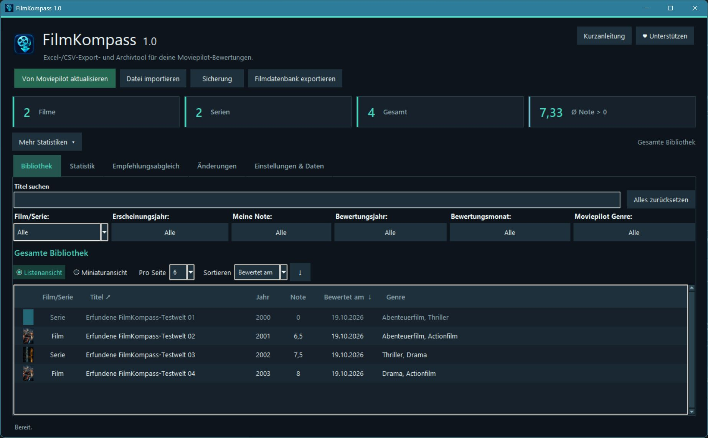

# FilmKompass 1.0

**Deine Moviepilot-Bewertungen einfach herunterladen, verwalten und sichern.**

FilmKompass ist ein kostenloses Windows-Programm zum Herunterladen, Durchsuchen, Filtern und Exportieren deiner öffentlich sichtbaren Moviepilot-Bewertungen. Deine Filmbibliothek wird lokal auf deinem Computer gespeichert.

**Kostenlos · Windows 11 · Open Source**

**[FilmKompass-Webseite mit weiteren Programmeinblicken](https://stigliz81.github.io/FilmKompass/)**

## FilmKompass herunterladen

- **[FilmKompass 1.0 für Windows](https://github.com/Stigliz81/FilmKompass/releases/download/v1.0.0/FilmKompass-1.0-Windows-portabel.zip)**
- [Python-Quellcode](https://github.com/Stigliz81/FilmKompass/releases/download/v1.0.0/FilmKompass-1.0-Quellcode.zip)
- [SHA256-Prüfsummen](https://github.com/Stigliz81/FilmKompass/releases/download/v1.0.0/SHA256SUMS.txt)

Keine separate Python-Installation nötig. Die EXE ist derzeit unsigniert; nutze diese offizielle Bezugsquelle und prüfe die Prüfsummen. Windows-Sicherheitsfunktionen müssen dafür nicht pauschal deaktiviert werden. Die Windows-Version ist für Windows 11 x64 vorbereitet.

## So sieht FilmKompass aus

*FilmKompass 1.0 mit erfundenen Beispieldaten.*

## Das kann FilmKompass

- **Bewertungen herunterladen:** Öffentliche Film- und Serienbewertungen aus deinem Moviepilot-Profil abrufen.
- **Bibliothek verwalten:** Titel durchsuchen und sortieren.
- **Intelligent filtern:** Nach Erscheinungsjahr, Note, Bewertungsdatum, Genre und Film-/Serientyp.
- **Excel und CSV:** Gesamte Bibliothek oder gefilterte Ergebnisse exportieren; vorhandene Dateien importieren.
- **Statistiken:** Deinen Filmgeschmack anhand verschiedener Auswertungen betrachten.
- **Miniaturansicht:** Titel alternativ als übersichtliche Karten anzeigen.
- **Datensicherung:** Bewertungen und zusätzliche lokale Informationen sichern.
- **Eigene Bilder:** Titelbilder bei Bedarf selbst hinzufügen.

## Installation und erster Start

1. Windows-ZIP herunterladen und vollständig entpacken.
2. `FilmKompass.exe` starten.
3. **Von Moviepilot aktualisieren** anklicken und deinen Profilnamen oder Profillink eingeben.
4. Bewertungen herunterladen, durchsuchen, filtern und bei Bedarf exportieren.

**Wichtig:** `_internal` gehört zum Programm und muss neben der EXE bleiben. Keine Administratorrechte oder zusätzliche Python-Installation erforderlich.

Eine neue Bibliothek startet leer. Vorhandene lokale Daten bleiben beim Start erhalten. Für den Moviepilot-Abruf benötigst du eine Internetverbindung.

## Hinweis zu deinem Moviepilot-Profil

Der Standarddownload benötigt öffentlich sichtbare Bewertungen. Aktiviere bei Bedarf vorübergehend **„Meine Bewertungen öffentlich zeigen“** in deinen Moviepilot-Profileinstellungen. Nach dem Download kannst du die Einstellung wieder deaktivieren.

Während der Freigabe können auch andere deine Bewertungen sehen. FilmKompass lädt ausschließlich Bewertungsinformationen herunter, keine Filme oder Videos.

## Deine Daten bleiben unter deiner Kontrolle

Die Speicherung erfolgt lokal. Es gibt keine automatische Übertragung deiner Bibliothek an KI-Dienste und keine automatische Cloud-Synchronisation. Du entscheidest, ob du Daten exportierst oder weitergibst.

Die SQLite-Datensicherung kann zusätzliche persönliche Informationen enthalten. Beim Gerätewechsel eigene Bilder separat mitsichern; Details stehen in der [Datenschutz- und Sicherungsanleitung](docs/DATENSCHUTZ.md).

## Häufige Fragen

**Kann ich Moviepilot-Bewertungen als Excel exportieren?**

Ja. Der Moviepilot Excel Export nutzt XLSX; alternativ steht CSV bereit. Deine Noten und Bewertungsdaten bleiben als Zahlen und Datumswerte in Excel nutzbar.

**Kann ich nur bestimmte Bewertungen exportieren?**

Ja. Filtere deine Bibliothek und exportiere die gefilterten Ergebnisse.

**Benötige ich einen Moviepilot-Login?**

Nein. Öffentliche Profilbewertungen lassen sich ohne Browseranmeldung herunterladen.

**Kann ich meine Moviepilot-Bewertungen sichern?**

Ja, als Excel/CSV oder als vollständiges lokales Moviepilot-Backup in SQLite.

**Kann ich öffentliche Moviepilot-Filmlisten herunterladen?**

Version 1.0 unterstützt deine persönliche Bewertungsliste. Beliebige Bestenlisten und thematische Filmlisten werden noch nicht unterstützt.

## Weitere Informationen

- [Ausführliche Funktionen und Filtermöglichkeiten](docs/FUNKTIONEN.md)
- [Datenschutz, Speicherung und Datensicherung](docs/DATENSCHUTZ.md)
- [Python-Installation, Entwicklung und technische Grenzen](docs/TECHNIK.md)

## Lizenz und Feedback

[MIT-Lizenz](LICENSE) · Copyright (c) 2026 Stigliz81 · [Fremdlizenzen](THIRD_PARTY_NOTICES.md)

Feedback und Verbesserungsvorschläge: **stigliz1981@gmail.com**

**FilmKompass ist ein unabhängiges Projekt und nicht offiziell mit Moviepilot verbunden.**
